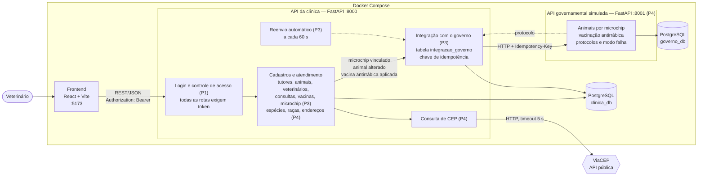
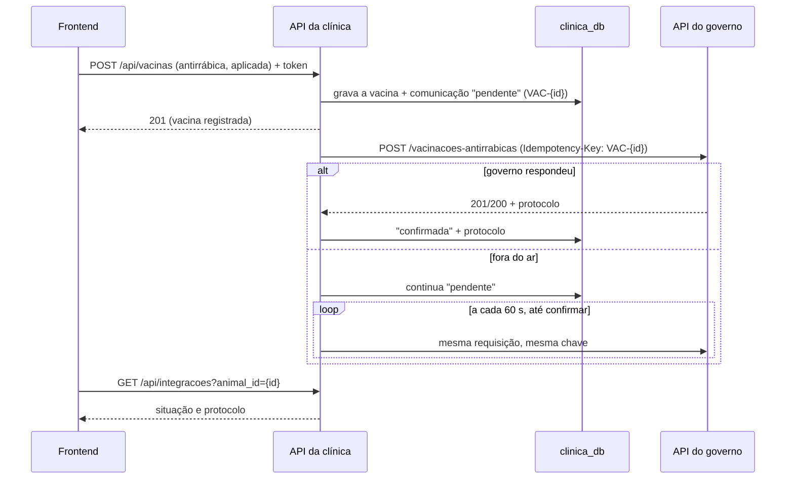

# Arquitetura do sistema — SDM

Três serviços independentes que só conversam por HTTP, cada API com o seu próprio banco:

- **Frontend web** (P5): React + Vite. Fala só com a API da clínica, por REST/JSON.
- **API privada da clínica** (P1, P3, P4): FastAPI. Login, regras de negócio, cadastros, ViaCEP e
  envio ao governo. Banco `clinica_db` (P2).
- **API governamental simulada** (P4): FastAPI. Serviço separado, com banco próprio (`governo_db`).
  Representa um sistema externo, então a clínica não acessa o banco dela e só se comunica por HTTP
  (enunciado 3.11).



## Camadas da API da clínica

```
api-clinica/app/
  main.py      -> cria a API, registra as rotas e exige login nas privadas
  deps.py      -> checagem do login (token válido, veterinário ativo e confirmado)
  core/        -> configuração (.env), senha e tokens
  db/          -> conexão com o banco
  models/      -> mapeamento das tabelas (SQLAlchemy)
  schemas/     -> entrada e saída com validação (Pydantic)
  routers/     -> endpoints
  services/    -> regras de negócio, ViaCEP, envio ao governo e reenvio
```

As tabelas são criadas pelos scripts de `db/` (P2). Os models só mapeiam o que já existe.

## Decisões

**Login com token (JWT).** O login devolve um token assinado, e o frontend manda esse token em toda
requisição (`Authorization: Bearer`). A API não guarda sessão em memória. No logout, o identificador
do token vai para a tabela `token_revogado` e ele deixa de valer antes de expirar (enunciado 3.1).

**Senha só como hash (bcrypt).** Nunca em texto puro (3.6).

**Confirmação de senha por link.** O "e-mail" é simulado: a API gera um link assinado que vale
24 h. Confirmar grava `senha_confirmada` e `data_confirmacao`, sem coluna nova no banco.

**Proteção num lugar só.** No `main.py`, depois de registrar o login, toda rota passa a exigir um
veterinário ativo e com senha confirmada. Rotas novas ficam protegidas automaticamente, e um teste
automático confere que nenhuma rota privada ficou aberta.

**Envio ao governo com pendência e reenvio.** Cada evento obrigatório (microchip, alteração do
animal, vacina antirrábica aplicada) grava o registro local e uma comunicação `pendente`. Logo depois
de responder ao usuário a API tenta enviar, e um processo em segundo plano reenvia o que ficou
pendente. Se o governo estiver fora do ar, nada se perde (seção 4).

**Idempotência.** Cada comunicação tem uma chave fixa, enviada em todas as tentativas. O governo
reconhece a repetição e devolve o mesmo protocolo, sem duplicar (seção 4, regra 6). Detalhes em
[contrato-integracao-governo.md](contrato-integracao-governo.md).

**Falhas externas tratadas.** ViaCEP e governo têm timeout de 5 s. CEP inexistente,
indisponibilidade e timeout viram mensagens claras para o usuário, sem erro 500.

## Fluxo da vacina antirrábica



Escolha de cada tecnologia: [tecnologias.md](tecnologias.md).
