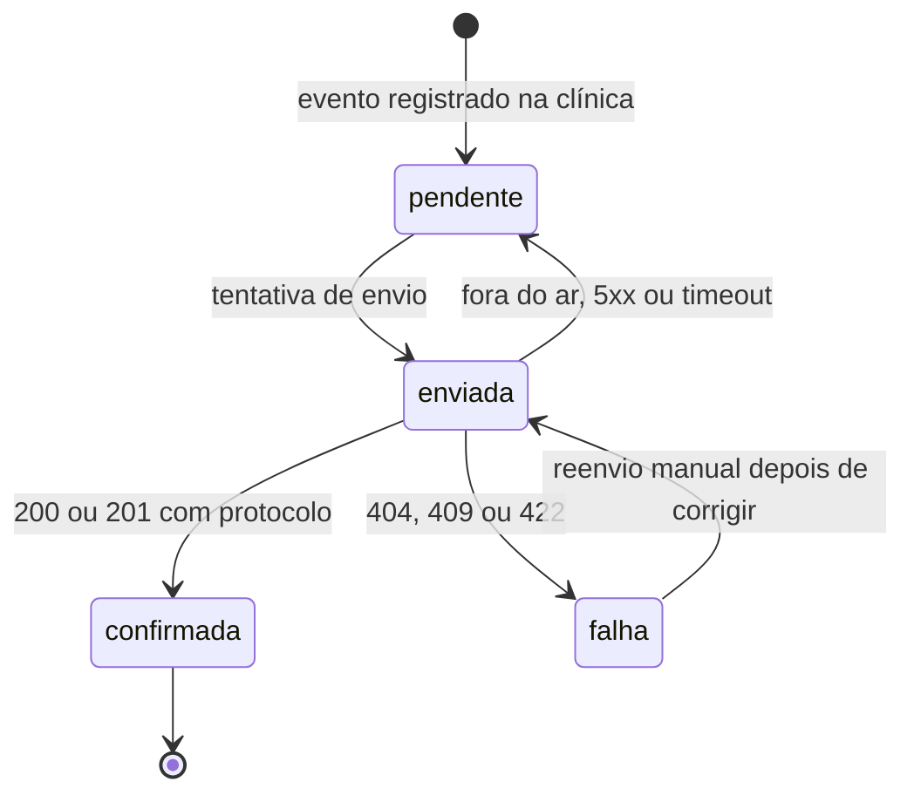

# Contrato de integração: API da clínica → API governamental

Documento do P1 (Milestone 4: contrato e regras de idempotência). Implementação: lado do governo
em `api-governo/` (P4, contrato detalhado em `api-governo/README.md`); lado da clínica em
`api-clinica/app/services/integracao.py` e `services/reenvio.py` (P3).

## Quando a clínica envia

| Evento na clínica | Operação no governo | Chave de idempotência |
|---|---|---|
| Microchip vinculado ou substituído (`POST /api/animais/{id}/microchip`, `.../substituir`) | `POST /api/governo/animais` | `CAD-{id do vínculo}` |
| Animal com microchip alterado (`PUT /api/animais/{id}`) | `PUT /api/governo/animais/{microchip}` | `ATU-{id do animal}-{momento}` |
| Vacina antirrábica aplicada (`POST` ou `PUT /api/vacinas`) | `POST /api/governo/vacinacoes-antirrabicas` | `VAC-{id da vacina}` |
| Vacina não antirrábica | nenhuma (seção 4, regra 7) | — |

Cada evento cria uma linha em `integracao_governo` com situação `pendente`, na mesma transação do
registro local. A vacina fica gravada mesmo que o governo esteja fora do ar (seção 4, regra 4).

## Dados enviados

O governo não conhece os ids da clínica: o envio usa nomes (espécie, raça, tutor) e identifica o
animal pelo microchip ativo.

### Animal (cadastro e atualização)

```json
{
  "microchip": "985112345678999",
  "nome": "Rex",
  "especie": "Cão",
  "raca": "Labrador",
  "sexo": "M",
  "data_nascimento": "2020-03-15",
  "tutor_nome": "Maria Silva",
  "tutor_cpf": "12345678901"
}
```

No cadastro vai o campo `microchip`; na atualização o microchip vai na URL.

### Vacinação antirrábica

Cabeçalho `Idempotency-Key: VAC-{id da vacina}`.

```json
{
  "microchip": "985112345678999",
  "vacina": "Antirrábica",
  "fabricante": "Zoetis",
  "lote": "L2026A",
  "data_aplicacao": "2026-10-20",
  "veterinario_nome": "Ana Lima",
  "veterinario_crmv": "12345",
  "veterinario_crmv_uf": "RJ",
  "animal": {
    "nome": "Rex", "especie": "Cão", "raca": "Labrador", "sexo": "M",
    "data_nascimento": "2020-03-15", "tutor_nome": "Maria Silva", "tutor_cpf": "12345678901"
  }
}
```

O bloco `animal` vai sempre: se o animal ainda não estiver no governo, ele é cadastrado junto com a
vacina (seção 4, regra 2).

## Regras de idempotência (seção 4, regra 6)

1. A chave é criada **uma vez**, junto com o registro local, e nunca muda entre as tentativas.
2. A coluna `integracao_governo.chave_idempotencia` é única: o mesmo evento não gera duas comunicações.
3. Todo envio leva o cabeçalho `Idempotency-Key`. Na vacina, o governo guarda a chave: mesma chave e
   mesmo conteúdo devolvem o **mesmo protocolo** (HTTP 200); mesma chave com conteúdo diferente dá 409.
4. No animal, o governo reconhece a repetição pelo microchip: o mesmo cadastro devolve o protocolo original.
5. Uma comunicação `confirmada` não é enviada de novo.

## Resultado de cada tentativa

| Situação | Quando |
|---|---|
| `pendente` | Criada e ainda não enviada; governo fora do ar (sem conexão, 5xx); sem resposta no prazo (timeout de 5 s); ou falta dado na clínica (ex.: animal ainda sem microchip) |
| `enviada` | Requisição em andamento |
| `confirmada` | Governo respondeu 200 ou 201; grava `protocolo_externo` e `data_resposta` |
| `falha` | Governo recusou os dados (404, 409, 422) ou o envio não faz mais sentido (ex.: microchip substituído antes do cadastro). Corrigir e reenviar manualmente |

Toda tentativa soma 1 em `tentativas` e grava o motivo em `mensagem_erro`. Assim a aplicação separa
o registro local (vacina gravada) da confirmação do governo (integração `confirmada`), como pede a
seção 4.



## Envio e reenvio (seção 4, regra 5)

- **Na hora:** logo depois de responder ao usuário, a API tenta enviar em segundo plano.
- **Automático:** a cada `INTEGRACAO_INTERVALO_SEGUNDOS` (60 s; 0 desliga), tudo que está
  `pendente` ou `enviada` é reenviado.
- **Manual:** `POST /api/integracoes/{id}/reenviar` (uma) ou `POST /api/integracoes/processar-pendentes` (todas).

## Consulta da situação (seção 4, regra 8)

- `GET /api/integracoes?animal_id=&situacao=&tipo_operacao=` — lista filtrada.
- `GET /api/integracoes/resumo` — quantas em cada situação.
- `GET /api/integracoes/{id}` — uma comunicação.
- No governo: `GET /api/governo/operacoes/{protocolo}`.

## Como demonstrar a falha (testes 14 a 16)

No Swagger do governo (http://localhost:8001/docs), `POST /api/governo/admin/modo-falha` com o
cabeçalho `X-Admin-Token: admin-sdm`:

| Corpo | Resultado na clínica |
|---|---|
| `{"tipo": "INDISPONIVEL"}` | A comunicação fica `pendente` (teste 14) |
| `{"tipo": "DESLIGADO"}` | O reenvio automático confirma (teste 15) |
| `{"tipo": "LENTO", "atraso_segundos": 10}` | Timeout: fica `pendente`; o reenvio devolve o mesmo protocolo (teste 16) |
| `{"tipo": "ERRO_VALIDACAO"}` | Fica `falha` |
