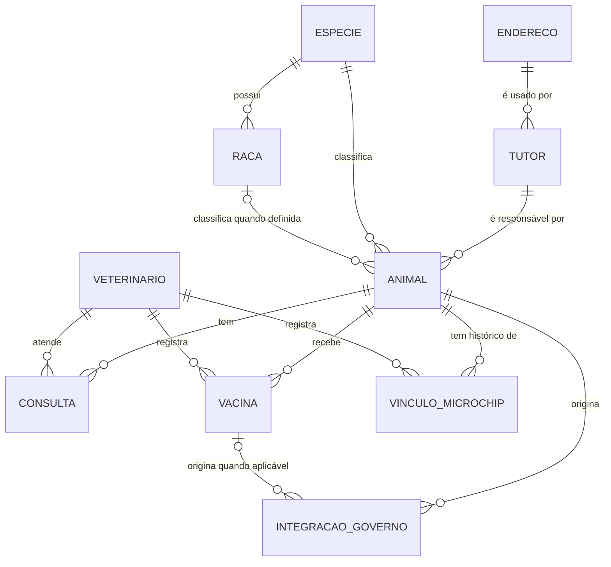
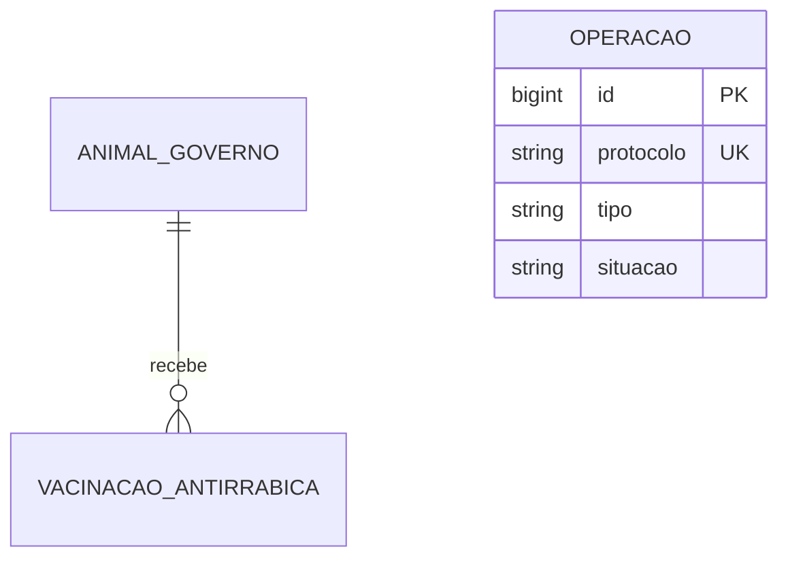

# Diagrama entidade-relacionamento e modelo relacional

O sistema usa dois bancos PostgreSQL independentes. A API da clínica envia eventos à API governamental simulada por HTTP. A clínica acompanha a comunicação pela chave de idempotência e pelo protocolo devolvido.

## Banco da clínica

Todos os campos `id` abaixo são chaves primárias. A coluna **Referências** indica as chaves estrangeiras físicas.

| Relação | Atributos além de `id` | Referências e unicidade |
|---|---|---|
| `endereco` | cep, logradouro, numero, complemento, bairro, cidade, uf, codigo_ibge | Pode ser usado por mais de um tutor. |
| `tutor` | nome_completo, cpf, data_nascimento, email, telefone, endereco_id, data_cadastro, situacao | `endereco_id → endereco.id`. CPF único. |
| `especie` | nome, descricao, situacao | Nome único. |
| `raca` | nome, descricao, situacao, especie_id | `especie_id → especie.id`. Par `(id, especie_id)` único. |
| `animal` | nome, data_nascimento, idade_estimada_meses, sexo, cor, peso_atual, tutor_id, especie_id, raca_id, situacao, data_cadastro | `tutor_id → tutor.id`, `especie_id → especie.id`, `(raca_id, especie_id) → raca.(id, especie_id)`. Raça opcional. |
| `veterinario` | nome_completo, cpf, crmv_numero, crmv_uf, email, telefone, senha_hash, senha_confirmada, data_confirmacao, data_cadastro, situacao, ultimo_acesso | CPF, e-mail e par `(crmv_numero, crmv_uf)` únicos. |
| `consulta` | animal_id, veterinario_id, data_hora, motivo, anamnese, sintomas, diagnostico, tratamento, prescricao, peso, temperatura, observacoes, situacao | `animal_id → animal.id`, `veterinario_id → veterinario.id`. |
| `vacina` | animal_id, veterinario_id, nome_vacina, tipo_vacina, antirrabica, fabricante, numero_lote, data_aplicacao, dose, via_aplicacao, data_proxima_dose, validade_lote, observacoes, situacao | `animal_id → animal.id`, `veterinario_id → veterinario.id`. Uma aplicação exige data. |
| `vinculo_microchip` | animal_id, codigo_microchip, veterinario_id, data_implantacao, data_vinculo, situacao | `animal_id → animal.id`, `veterinario_id → veterinario.id`. Código único. Índice parcial garante um chip ativo por animal. |
| `integracao_governo` | animal_id, vacina_id, tipo_operacao, protocolo_externo, chave_idempotencia, situacao, data_solicitacao, data_resposta, tentativas, mensagem_erro | `animal_id → animal.id`, `vacina_id → vacina.id` quando aplicável. Chave de idempotência única. |

A autenticação adiciona `token_revogado(jti, expira_em)`, com `jti` como chave primária. Essa tabela registra o identificador do token encerrado no logout.

## Banco governamental simulado

| Relação | Atributos além de `id` | Referências e unicidade |
|---|---|---|
| `animal_governo` | microchip, nome, especie, raca, sexo, data_nascimento, tutor_nome, tutor_cpf, data_registro, data_atualizacao | Microchip único. |
| `vacinacao_antirrabica` | animal_id, fabricante, lote, vacina, data_aplicacao, veterinario_nome, veterinario_crmv, chave_idempotencia | `animal_id → animal_governo.id`. Chave de idempotência única. |
| `operacao` | protocolo, tipo, situacao, data, mensagem | Protocolo único. O registro de operação é independente de uma chave estrangeira. |

Scripts de referência: [clínica](../db/clinica/01_criar_tabelas.sql) e [governo simulado](../db/governo/01_schema.sql). A tabela de tokens revogados está no script `db/clinica/03_sessoes.sql` da [revisão de autenticação](https://github.com/Projeto-A3-Sistemas/Projeto-A3-Sistemas-IBMR/pull/4).
